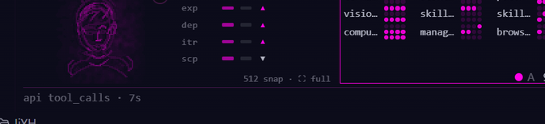
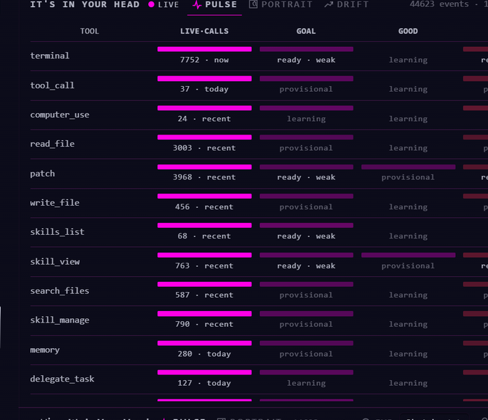
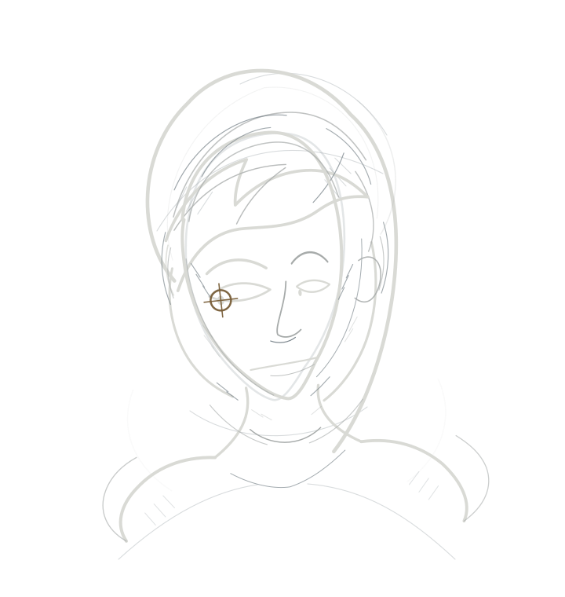
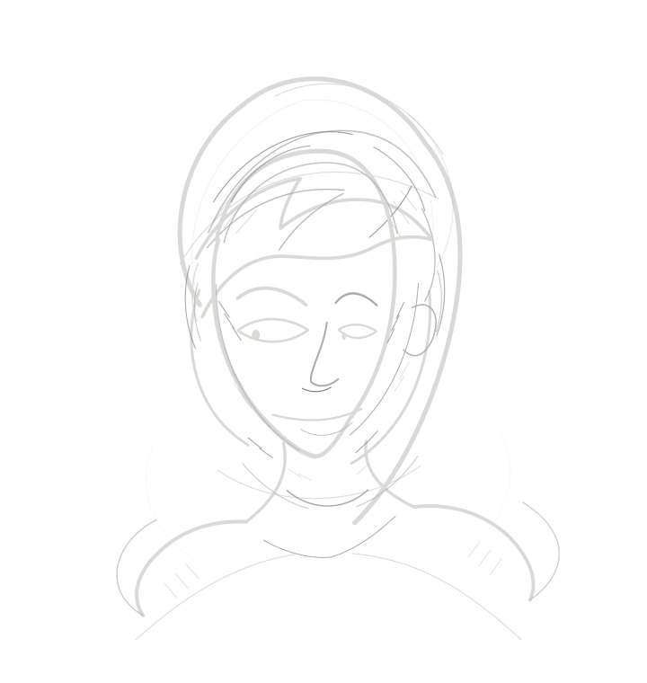
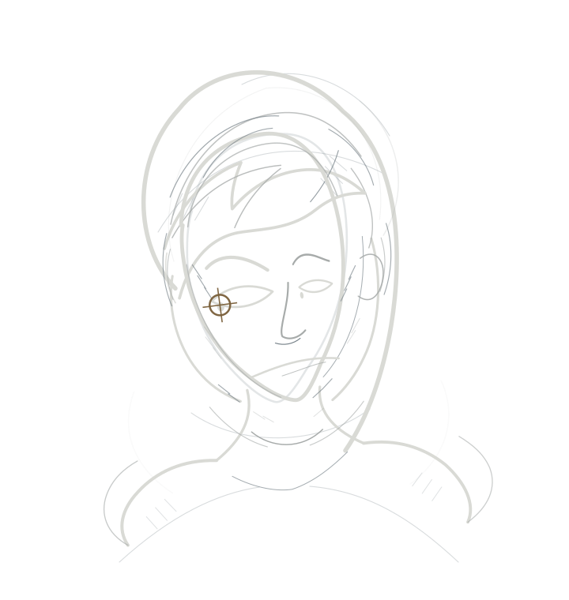
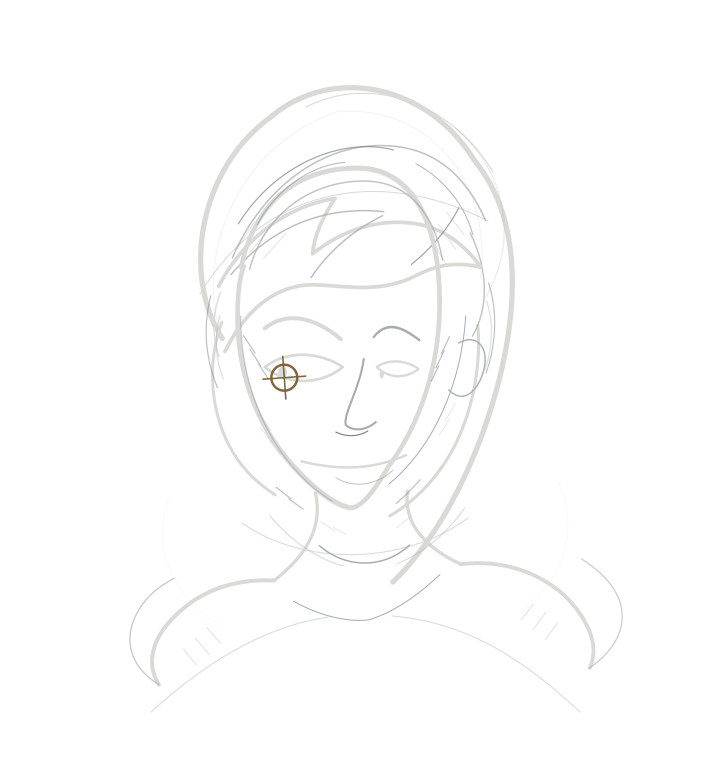
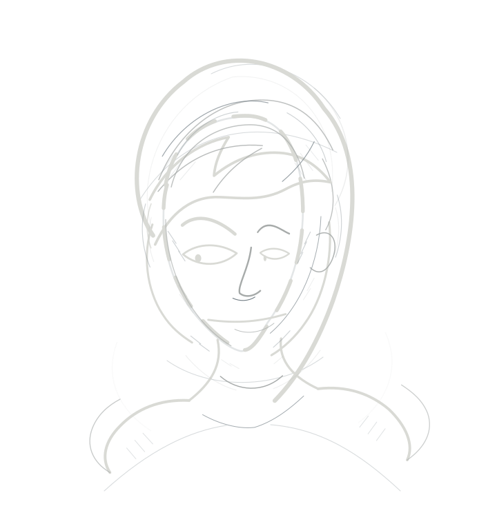
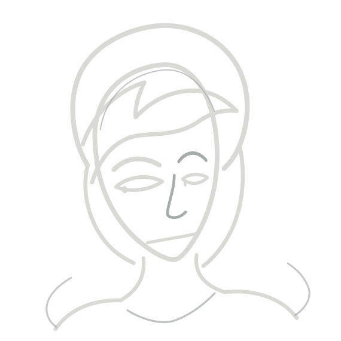
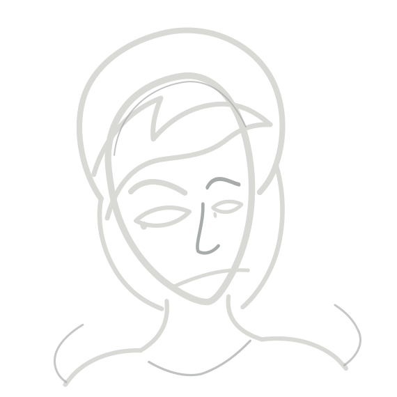

# It's in Your Head

A calm instrument for seeing **how you actually work with Hermes** — live
activity, a portrait of your working style, and the trends underneath it.
It watches signals, not words: your prompts and reasoning are never stored,
and nothing leaves your machine by default.

## What it gives you

- **Awareness without interruption.** A 96px strip sits at the edge of the
  desktop app and shows your session's pulse at a glance — which tools are
  active, and whether the work is trending toward your goal, going well, or
  hitting friction. You stop guessing whether a session is going well.
- **A mirror of your working style.** A six-dimension portrait derived from
  real signals (tools, turns, friction) — how you work, not what you think.
  It builds over time and stays honest: weak evidence reads as provisional,
  never as false confidence.
- **Drift you can catch early.** Trend series show when your workflow shifts,
  so you notice a change in direction before it becomes a problem.
- **Gentle, opt-in adaptation.** If you enable it, the plugin can offer one
  bounded directional instruction per turn, driven by independent
  goal / good / friction channels. It never nags, and it is off by default.
- **It stays out of the way.** Zero network by default, no raw text on disk,
  a compact instrument instead of another dashboard to babysit.

## The surfaces

### The strip — what you see at all times

The 96px instrument docks to the bottom of the desktop app: live tool-call
matrix, portrait sketch, four trend bars and a ticker. Labels ellipsize by
design at the compact width.

### The workspace — expand for inspection

The strip's expand icon (top-right, next to `?`) opens the wider PULSE view:
a per-tool table with live-call volume and goal / good / friction state.

### `/mirror` — the chat quick reference

| command | what it shows |
|---|---|
| `/mirror` | dataset line (events + tokens) |
| `/mirror pulse` | goal / good / friction state per label |
| `/mirror portrait` | six dimensions + confidence |
| `/mirror portrait draw` | deterministic ASCII face + six-axis evidence strip |
| `/mirror drift` | six-dimension series (last 8 points) |
| `/mirror context` | context-visibility audit (what the model can / can't see) |
| `/mirror reset [--yes]` | wipe the dataset — confirmation-gated, config untouched |
| `/mirror adaptation [on\|off\|status\|rules]` | directional adaptation state + rules |
| `/mirror engine [status\|enable\|disable]` | perception tier (Tier-0 default, opt-in ONNX Tier-1) |

## The face changes with your work

The portrait isn't a static avatar — it's a live expression of your working
state. These are real renders from the portrait engine, driven to each state
and settled (not mockups):

| rest | open | locked | aligned | tense |
|:--:|:--:|:--:|:--:|:--:|
|  |  |  |  |  |
| nothing to read | curious, exploring | analytical, locked in | warm, in resonance | diverging, uncertain |

At strip size — what you actually see at a glance:

| rest | locked |
|:--:|:--:|
|  |  |

The two poles read cleanest: *open* (exploring) vs *locked* (focused). The six
measured dimensions are projected into a few display channels — openness,
focus, warmth — so the face bends with how you're working, not with what you
say. The fuller story lives in the [wiki](wiki/capabilities.md).

## How it works

Observer hooks capture work signals on the hot path (capture + enqueue only —
no I/O, no network, no database on the token path). A background worker
aggregates them into plugin-local WAL SQLite. The perception engine derives
features from those signals:

- **Tier-0 (default):** lightweight sketch embeddings, stdlib-only, zero
  dependencies, zero network. Tool prototypes, the six-dimension portrait,
  pulse/drift views and deterministic adaptation rules all run on this tier.
- **Tier-1 (opt-in):** local paraphrase-multilingual-MiniLM-L12-v2 ONNX
  inference in an isolated, PM-managed worker. Enabled only by explicit user
  action (`/mirror engine enable`). The default install downloads only the
  int8 artifact set (~135 MB incl. tokenizer/config); fp32 is a separately
  selectable variant. The downloader is size-capped at the pinned manifest,
  writes atomically, and leaves zero bytes behind on any failure. Any ONNX
  failure degrades to Tier-0 automatically.

The desktop pane uses theme-variable-only styling with ResizeObserver plus a
mandatory polling fallback, so it renders correctly across themes and sizes.

## Privacy

- **Nothing leaves the machine.** All storage is local:
  `plugin-data/its-in-your-head/` (WAL SQLite). The default Tier-0 layer is
  stdlib-only with zero network.
- **Raw prompts are not stored.** Event rows carry derived feature vectors /
  sketches and metadata only — never raw prompt or conversation text.
- **Reasoning capture (when enabled)** requires the profile setting
  `plugins.stream_reasoning_deltas: true`. Raw deltas reach the plugin
  transiently, are buffered in memory for the stream, and discarded at the
  boundary. Only derived features are persisted: event sketches for turn rows
  and derived pattern-affinity numbers for scored reasoning — no reasoning
  sketch BLOB (discard-after-scoring). No raw reasoning text ever hits disk.
- **Tier-1 ONNX is opt-in.** Nothing downloads or runs unless you explicitly
  confirm; inference is local CPU-only in an isolated worker, pinned by
  revision + SHA-256 manifest, size-capped.

## Disclosures (catalog Rule 13)

- **Data access** — Reads the Hermes-provided tool, session, API and stream
  hook payloads. Reasoning deltas are optional and transient (captured only
  when the profile sets `plugins.stream_reasoning_deltas: true`, buffered in
  memory for the stream and discarded at the boundary; only derived features
  are persisted). Does not inspect arbitrary user files or credential stores.
- **Network** — No network by default. The explicit ONNX enable
  (`/mirror engine enable`) downloads the revision- and SHA-256-pinned model
  from Hugging Face once. Maintainer-only model repinning also contacts
  Hugging Face. No other network calls.
- **Processes** — A background aggregation worker; an optional persistent
  Python ONNX subprocess (PM-isolated); and a detached watchdog process used
  exclusively to clean up the ONNX worker on exit (Windows Job Object
  containment + stale-worker reaping). No shell-command execution.
- **Credentials** — No stored credentials, no provider-token forwarding to
  the worker, no external telemetry. The worker receives an explicit
  environment allowlist (PATH, HOME, LANG, LC_ALL and Windows
  SYSTEMROOT/TEMP/TMP) and does not inherit Hermes provider credentials.
- **Storage** — Derived analytics, caches and (opt-in) model files remain in
  the active Hermes profile's plugin data directory
  (`plugins.plugin_storage.plugin_data_dir("its-in-your-head")`). Raw prompts
  and reasoning are never stored.

## Install

**From the catalog / deep link:**

`hermes://plugin/install?repo=hi4c0ck/its-in-your-head&enable=1`

**Manual:** copy this folder into the profile plugins root
(`~/.hermes/profiles/<profile>/plugins/` or the default profile root), add
`its-in-your-head` to `plugins.enabled` (equivalently:
`hermes -p <profile> plugins enable its-in-your-head`), then enable the
desktop half in Capabilities > Plugins.
Verify: `hermes -p <profile> plugins doctor its-in-your-head --ci`.

### Enable / disable

Settings → Plugins → **It's in Your Head**: the **backend** toggle runs the
agent half (hooks, telemetry, `/mirror`); the **desktop** toggle mounts the
pane. The halves are independent — the pane keeps showing whatever the
backend last flushed.

## Tests & gates

`<hermes venv python> -m pytest -q` (pytest.ini pins importlib import mode,
repo-local basetemp, and temp-budget retention). CI (GitHub Actions,
windows + linux × py3.11/3.12/3.13) runs contract checks, the full suite,
the temp-budget gate, and desktop node checks on every push.
