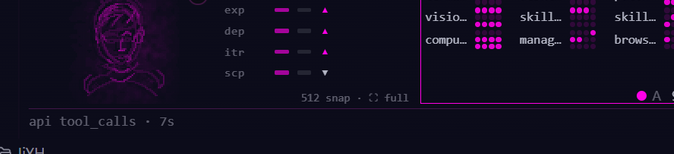
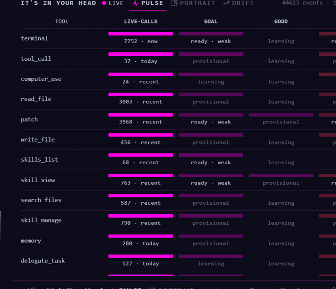

# It's in Your Head


> **Official main-view artwork** (plugin release). Lives in `assets/iyyh-main-view.jpg`;
> referenced here as the repo banner + the release cover.

Hermes Agent plugin: local work-signal observation + a 96px desktop signal
strip. Watches HOW you work (tools, turns, friction) — it does not claim to
know what you think. v0.1.0 functional preview; v0.1.1 hardening release:
upgrade-safe database migration, reasoning/feedback wired into the
perception engine, semantic desktop views, smaller optional ONNX install.

## What it does

- **Telemetry** (hot-path observer hooks): capture + enqueue only; no I/O,
  no network, no DB on the token path. Aggregation happens in a background
  worker into plugin-local WAL SQLite.
- **Perception engine**: Tier-0 lightweight sketch embeddings (stdlib, zero
  dependencies) as the default; tool prototypes, the six-dimension portrait,
  pulse/drift views, deterministic adaptation rules (opt-in, off by default).
- **Desktop strip**: bottom-docked 96px pane with PULSE / PORTRAIT / DRIFT
  semantic views, theme-variable-only styling, ResizeObserver + mandatory
  polling fallback.
- **Optional Tier-1 ONNX** (explicit user action only): local
  paraphrase-multilingual-MiniLM-L12-v2 inference in an isolated, PM-managed
  worker environment. Default install downloads only the int8 artifact set
  (~135 MB incl. tokenizer/config); fp32 is a separately selectable variant.
  The downloader is size-capped at the pinned manifest, writes atomically,
  and leaves zero bytes behind on any failure. Any ONNX failure degrades to
  Tier-0 automatically.

## Privacy

- **Nothing leaves the machine.** All storage is local:
  `plugin-data/its-in-your-head/` (WAL SQLite). The default Tier-0 embedding
  layer is stdlib-only with zero network.
- **Raw prompts are not stored.** Event rows carry derived feature vectors /
  sketches and metadata only — never raw prompt or conversation text.
- **Reasoning capture (when enabled)**: with the required profile setting
  `plugins.stream_reasoning_deltas: true`, raw reasoning deltas reach the
  plugin **transiently** — buffered in memory for the duration of the stream
  and discarded at the boundary. Only derived features are persisted: event
  sketches for turn rows and derived pattern-affinity numbers for turns with
  scored reasoning — no reasoning sketch BLOB (discard-after-scoring).
  No raw reasoning text ever hits disk.
- **Tier-1 ONNX is opt-in**: nothing downloads or runs unless you explicitly
  confirm the install; inference is local CPU-only, in an isolated worker
  process, pinned by revision + SHA-256 manifest, size-capped.

## Install (manual)

Copy this folder into the profile plugins root
(`~/.hermes/profiles/<profile>/plugins/` or the default profile root), add
`its-in-your-head` to `plugins.enabled` (equivalently:
`hermes -p <profile> plugins enable its-in-your-head`), then enable the
desktop half in Capabilities > Plugins.
Verify: `hermes -p <profile> plugins doctor its-in-your-head --ci`.

## Dev install / catalog

`hermes://plugin/install?repo=hi4c0ck/its-in-your-head&enable=1`

## Manual — the basic tools

### The strip (what you see at all times)

The 96px instrument docks to the bottom of the desktop app: live
tool-call matrix, portrait sketch, four trend bars and a ticker. Labels
ellipsize by design at the compact width.



### The workspace (expand for inspection)

The strip's expand icon (top-right, next to `?`) opens the wider PULSE
inspection view: per-tool table with live-calls volume + goal / good /
friction state.



### `/mirror` — the chat quick reference

| command | what it shows |
|---|---|
| `/mirror` | dataset line (events + tokens) |
| `/mirror pulse` | goal / good / friction state per label |
| `/mirror portrait` | six dimensions + confidence |
| `/mirror portrait draw` | deterministic ASCII face + six-axis evidence strip |
| `/mirror drift` | six-dimension series (last 8 points) |
| `/mirror context` | context-visibility audit (what the model can / can't see) |
| `/mirror reset [--yes]` | wipe the dataset — confirmation-gated, config untouched |
| `/mirror adaptation [on\|off\|status\|rules]` | directional adaptation state + rules |
| `/mirror engine [status\|enable\|disable]` | perception tier (Tier-0 default, opt-in ONNX Tier-1) |

Sample output (live dataset):

```text
$ /mirror
mirror: 44580 events, 1124716257 tokens

$ /mirror portrait draw
portrait draw:
                           ...
      :    \         /  :
      :                 :
      :     -       -   :
      :        v        :
      :-----------------------:
      dir +0.50 c   - | ctx +0.54 c   - | exp +0.51 c   -
      dep +0.51 c   - | itr +0.50 c   - | scp +0.50 c   -
      stage none | seed true | line 0.21 | asym 0.03 | evidence present

$ /mirror context
context:
  user message: VISIBLE
  history extent: KNOWN
  system instructions: NOT EXPOSED
  SOUL.md: KNOWN
  USER.md: KNOWN
  MEMORY.md: KNOWN
  AGENTS.md: KNOWN
  active skills: KNOWN
  plugin adaptation: KNOWN
  injected instruction: KNOWN

$ /mirror engine status
engine:
  Tier 0: tier-0 (sketch, always available) [active]
  Tier 1: tier-1-onnx (ONNX MiniLM)
  Active tier: Tier 0
  ONNX runtime: ok
  Worker: dead
```

(The `portrait draw` face above is abridged — the live output is a full
25×14 deterministic character face; the axis lines are the evidence strip.)

### Enable / disable

- Settings → Plugins → **It's in Your Head**: the **backend** toggle runs
  the agent half (hooks, telemetry, `/mirror`); the **desktop** toggle
  mounts the pane. The halves are independent — the pane keeps showing
  whatever the backend last flushed.
- Zero-network by default. ONNX Tier-1 is opt-in: `/mirror engine enable`
  downloads the pinned model once; inference is local CPU-only in an
  isolated worker process.

## Tests & gates

`<hermes venv python> -m pytest -q` (pytest.ini pins importlib import mode,
repo-local basetemp, and temp-budget retention). CI (GitHub Actions,
windows + linux × py3.11/3.12/3.13) runs contract checks, the full suite,
the temp-budget gate, and desktop node checks on every push.
