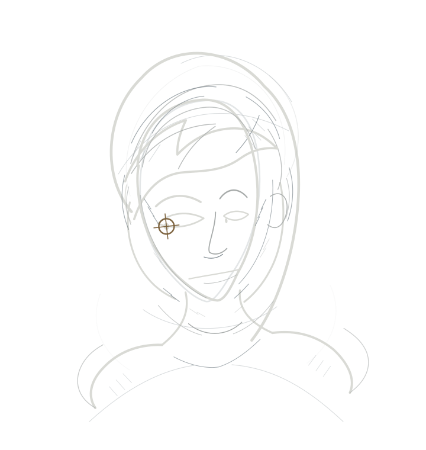
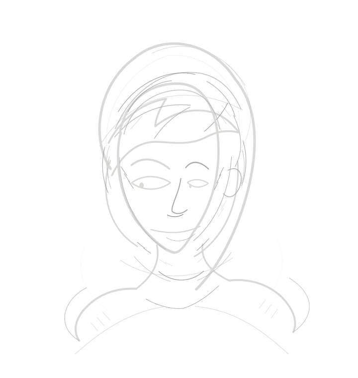
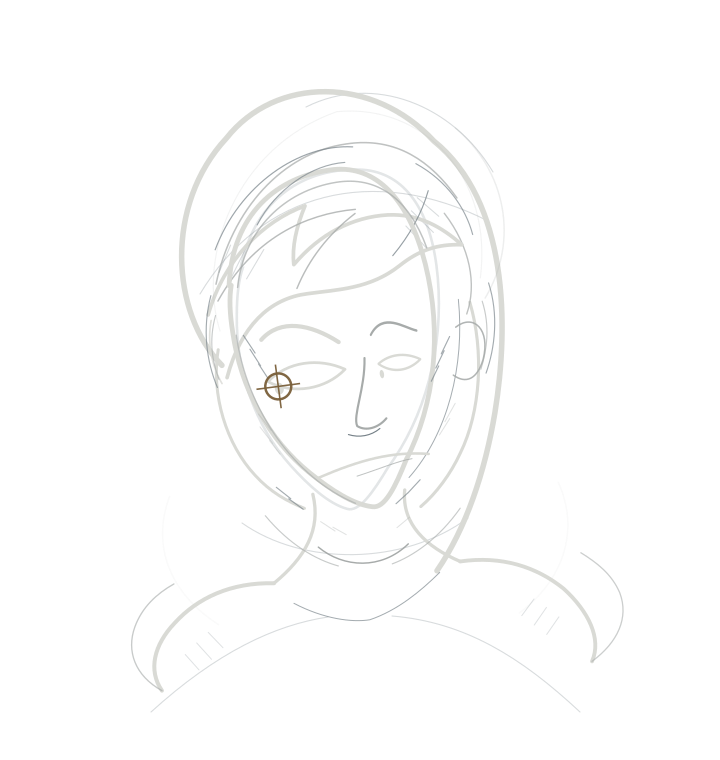
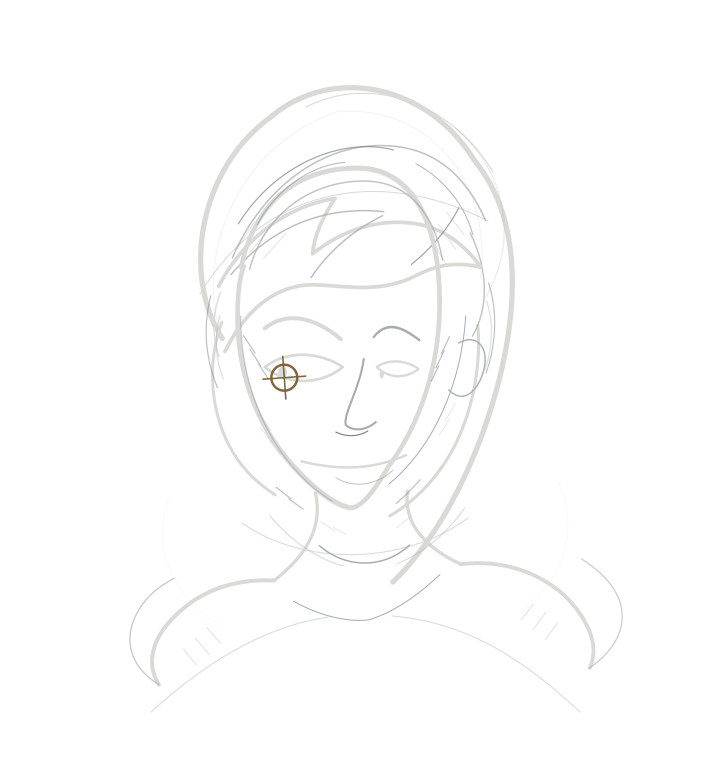
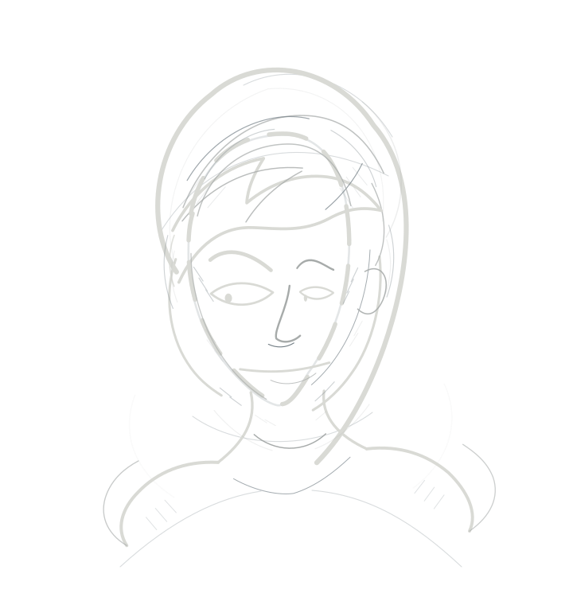
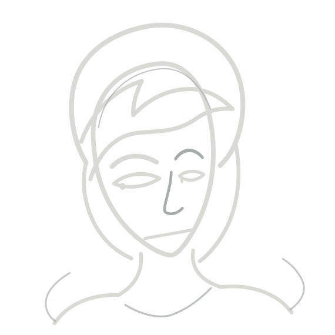
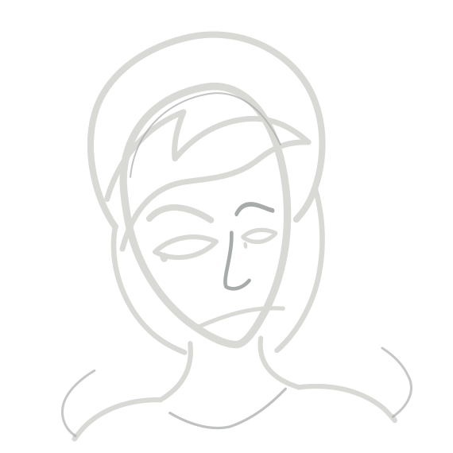

# It's in Your Head — what it's for you

> A quiet instrument that watches **how you work** — the tools you reach for, the
> turns you take, where you get stuck. Not a chat window, not a log: a glance. Over
> time it learns the shape of your working style, so the assistant you're talking to
> finally works the way you do.

This page is the user-facing overview: what it feels like to use, what each part
does, why the privacy holds, and what the mirror actually draws. It deliberately
reads as an explanation, not a slogan.

## A quiet hour, observed

What a real session looks like:

| time | moment | what you notice |
|------|--------|-----------------|
| 09:14 · you start | **Nothing to do with it — that's the point.** | The strip is there, unobtrusive: a thin line of light at the bottom of the screen. It's just watching. You get on with the task the way you always do. |
| 09:16 · the work moves | **The pulse reads “good.”** | The tools you're using are landing, the turns are short, you're in a groove. The pulse tells you the assistant is cooperating. You don't have to check. |
| 09:32 · you start to spin | **For the first time, the circling has a name.** | You've opened the same file three times in ten minutes. The pulse shifts to *friction*. Instead of wondering if something's wrong, you can see that something is — so you stop pretending it isn't and go look at what's actually stuck. |
| 09:40 · you check the room | **One glance, one fix.** | `/mirror context` — the model wasn't seeing the artifact you meant to attach. No more guessing “did it even read the file?” You correct it in one line and move on. |
| 10:05 · the session ends | **The portrait reads you back.** | Blunt, focused, deep. That's your style, measured from what you actually did — not what you said. Next session, that's not something you have to re-explain. It just adapts. |

## What each part actually does

### The pulse
The pulse watches how the assistant's tool-calls are going — are they landing
(**good**), have you locked onto a goal (**goal**), or is something stuck
(**friction**)? It's a state, not a score. The point is that “am I making progress
or spinning?” stops being a vague feeling and becomes something you can see in a
glance.

### Drift
The portrait is a single point; drift is the line. It tracks how each of the six
axes moves across a session, so you can see when you widen your scope or when you
tighten up — the way your style actually bends, not a snapshot frozen in time.

### The context audit
Before you can trust an answer, you have to know what the model could see. The
audit lays that out plainly: what was in reach this turn, what wasn't, and what
the answer is actually built on. It turns “does it even know what I meant?” into
something you can check, not assume.

### Adaptation
Turn it on, and the plugin can steer the assistant toward your working style — one
small, directional instruction per turn, and nothing more. It's deliberately narrow,
so the tool bends to you without ever surprising you. Off by default, and yours to
switch on.

### The portrait
Every session, the plugin measures your style across six axes — **directness,
context richness, exploration, analytical depth, iteration, scope**. It's derived
from what you actually did, not what you said, and it carries a confidence reading
so it tells you how sure it is. It's a chart, not a guess — and not a mind-reader:
it only ever watches how you work.

## What the mirror actually draws

The faces below are **real renders from the portrait engine** — driven to each
working state and settled at `t = 0` — not mockups. (Source:
[`tools/portrait_motion_tuner.html`](../tools/portrait_motion_tuner.html).)

| **rest** | **open

** | **locked** | **aligned** | **tense** |
|:--:|:--:|:--:|:--:|:--:|
|  |  |  |  |  |
| nothing to read | curious, exploring | analytical, locked in | warm, in resonance | diverging, uncertain |

At strip size — what you actually see:

| **rest** | **locked** |
|:--:|:--:|
|  |  |

**The two poles read cleanest.** *open* (exploratory — openness up, focus flat)
vs *locked* (strong focus — openness down, focus up). Nudge openness and focus
**apart** and the face is legible; push them the same way and they cancel into
“nothing.”

> **Why, in one line:** the six *measured* dimensions are *projected* into a few
> display channels — `openness`, `focus`, `warmth` — by the expression layer. They
> aren't extra stats; they're weighted blends of the six (e.g.
> `openness = 0.42·directness + 0.38·exploration + 0.20·scope`). `openness` and
> `focus` act on the shared features in opposite signs (brow `+8 / −6`, eye
> aperture `+0.18 / −0.08`), so moving them in opposite directions is what gives
> the sharpest, most legible poses.

## Why you can just let it watch

Everything above only works because of one thing: **nothing leaves your machine.**
No telemetry, no stored prompts, no credentials, no shell commands. It's local, it
lives in the active profile's own storage, and it's yours to wipe clean with a
single command. You're the owner of this data — not the product of it. That's not a
privacy checkbox; it's the reason the rest of it can be this quiet.

## How it actually works (the real path)

1. **Capture (hot path).** Nine Hermes hooks fire on every tool call / API / stream
   / session event. Each just queues a tiny record — which tool, how long,
   success/fail, turn index. No prompt text, no reasoning, no credentials. ~Zero
   work.
2. **Aggregate (off the hot path).** A separate, env-isolated background worker
   drains that queue on a tick and writes **derived features** to a local WAL
   SQLite in the profile's `plugin-data`. This is where the real compute happens:
   per-tool success/latency rates, turn patterns, the six-dimension portrait +
   confidence. Raw prompts are never written — only these aggregates.
3. **Perceive.** The six dims drive the portrait. The default tier is a
   dependency-free stdlib “sketch” embedding; the optional tier is a real ONNX
   multilingual MiniLM, downloaded only when you explicitly enable it (SHA-pinned,
   size-capped, local CPU), falling back to the sketch on any failure.
4. **Surface.** The 96px strip + `/mirror` read from that local DB and show pulse,
   portrait, drift, and context.
5. **Adapt (opt-in).** If you switch it on, it emits at most one bounded,
   deterministic instruction per turn steering the assistant toward your style.
   Off by default.

End to end: **hooks → in-memory queue → isolated worker → local WAL SQLite
(features, never raw prompts) → perception → strip + /mirror → optional
one-line adaptation.** All local, all profile-scoped.

---
Because it observes your personal work behavior, it's private by *construction*, not
just by setting — a per-person local instrument, not a public service. See the
catalog Rule 13 disclosure in [`README.md`](../README.md).
